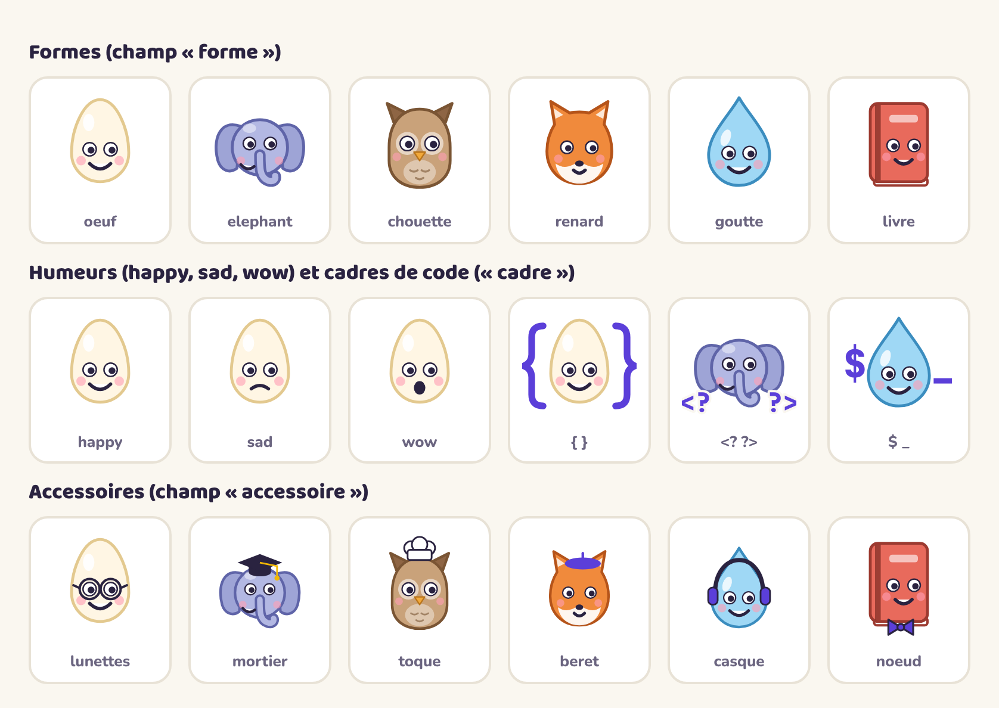

# Modèle : une appli façon Duolingo pour chaque cours

Un moteur d'apprentissage prêt à l'emploi : leçons de 5 minutes, 23 types d'exercices, XP, séries de jours, badges, défi du jour, révisions espacées, fiches de théorie, mode sombre, appli installable sur téléphone et utilisable hors connexion. Pour les cours de programmation : du vrai code exécuté et testé dans le navigateur (JavaScript, PHP), avec les erreurs expliquées en français ; pour les autres langages (Java, Python, C, SQL…), du code coloré et des exercices de lecture, sans exécution.

Issu de [Pampre](https://github.com/williamdonze/pampre) (le vin) et de [ProgWeb 2](https://github.com/williamdonze/progweb2) (JavaScript).

## Créer l'appli d'un nouveau cours

1. Sur GitHub, en haut de ce dépôt : **Use this template → Create a new repository** (par exemple `cours-php`).
2. Ouvre une session Claude Code sur le nouveau dépôt.
3. Tape **`/nouveau-cours`** et envoie les supports du cours (zip des pages d'exercices, slides, PDF, lien du site).
4. Claude te pose toutes ses questions d'un coup (type de cours, projet, examen, difficultés, nom, mascotte), te propose un programme d'unités ; tu valides ; il écrit les unités (chacune dans son propre contexte, pour aller plus vite), les teste, génère le README du cours, et pousse.
5. Mise en ligne : **Settings → Pages → Deploy from a branch → `main`, `/ (root)`**. Le site est à `https://<ton-compte>.github.io/<dépôt>/`.

Ensuite :
- **la suite du cours** : dépose les nouveaux fichiers dans `supports/` (sur GitHub : *Add file → Upload files*), puis tape **`/ajouter-supports`** ;
- **une unité à la fois** (pour étaler le travail sur plusieurs sessions) : **`/ecrire-unite u05`** ;
- **les améliorations du modèle** : **`/mettre-a-jour-moteur`** dans le dépôt du cours.

## Ce qu'il y a dedans

<p align="center"></p>

- **`content/`** : tout le contenu, en JSON (une unité par fichier). La section `app` de `content/config.json` règle le nom, la mascotte (forme, accessoire, cadre de code, ou dessin libre), les couleurs et les **modules** (`code-js` pour du JavaScript, `dom` pour des pages web, aucun pour un cours sans code).
- Deux **unités d'exemple** : « Bien apprendre » (un cours sans code, avec un boss « étude de cas ») et « Catalogue des exercices » (un exemple de chaque type). Elles sont retirées quand on crée un vrai cours.
- **`docs/format-contenu.md`** : la référence du format ; **`docs/format-memo.md`** : son mémo court. **`docs/modules.md`** : les langages (JavaScript et PHP exécutés ; Java, Python, C, SQL… sans exécution) et comment en faire exécuter un nouveau. **`docs/feuille-de-route.md`** : les améliorations prévues.

## Lancer et tester

```bash
python3 -m http.server 8765                    # puis http://localhost:8765/
pip install playwright && playwright install chromium   # une fois, pour les tests
python3 tools/valider-contenu.py && python3 tools/tester-exercices.py && python3 tools/test-parcours.py
python3 tools/configurer.py                    # après avoir changé le nom, la mascotte ou les couleurs
```
